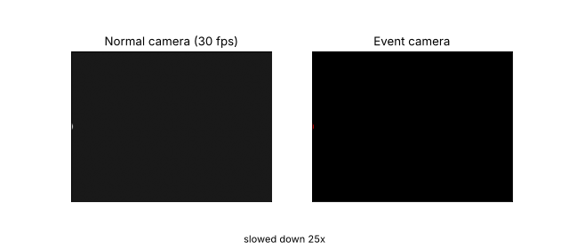
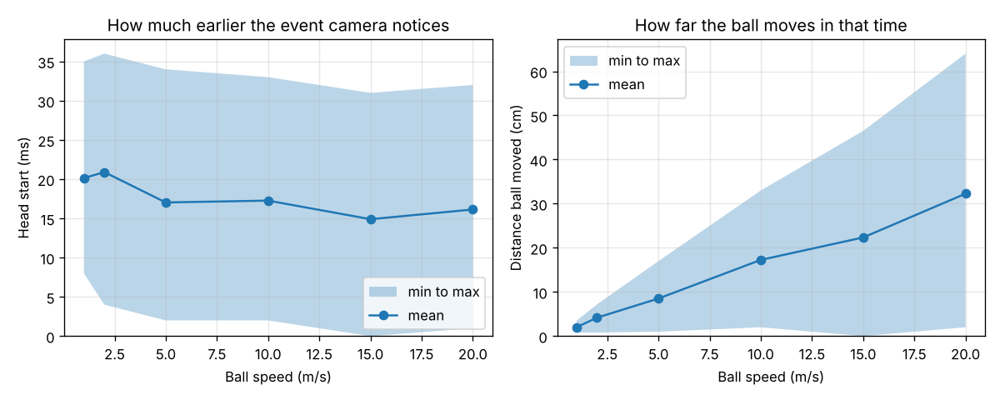
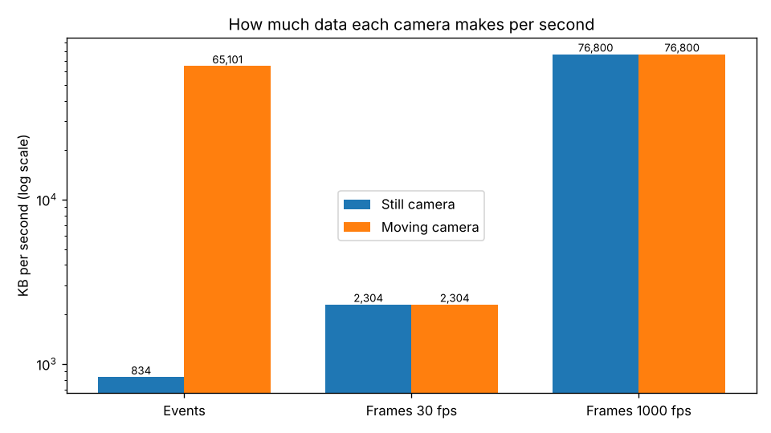

# Event Camera Simulator

A simple Python simulation of how an event camera "sees" a fast ball, compared with a normal 30 fps camera.



## How it works
- A fake 320 x 240 scene is drawn every 1 ms: a bright ball flies left to right across a dark background.
- The **event camera** checks every pixel every 1 ms. When a pixel's (log) brightness changes by more than a threshold, it sends an "event": red if it got brighter, blue if it got darker.
- The **normal camera** takes a full picture only every 33 ms (about 30 fps), starting at a random moment.
- We compare when each camera first "notices" the ball, and how much data each one makes.

## Results

### Dodge test: who notices the ball first?


Left: how many milliseconds earlier the event camera notices the ball. Right: how far the ball travels in that time. Raw numbers are in `results/dodge_test.csv`.

### Data size: how many bytes per second?


Numbers are in `results/data_size.md`.

### Findings
TODO: write in your own words

## Real-world test
<!-- REAL WORLD START -->
Add a video to the videos folder and run phone_demo.py.
<!-- REAL WORLD END -->

## Limitations
- Synthetic scene, not real footage.
- Simple sensor model: no noise, no per-pixel threshold differences, no refractory period, no readout or bandwidth limits.
- Real sensors cap their event rate and drop events when overloaded, so the "moving camera" event data could not really get that big.
- Head start counts only when each camera first "notices" the ball; it ignores processing time on a real drone.
- 1 ms simulation steps, so event timing is 1 ms here, not microseconds like a real sensor.
- Real-world test (phone_demo.py): event timing is only as fine as the video's frame gap (about 4 ms at 240 fps, 33 ms at 30 fps), and video compression adds some fake events.

## How to run
```bash
python -m venv .venv
source .venv/bin/activate        # on Windows: .venv\Scripts\activate
pip install -r requirements.txt
python make_gif.py               # Step 1: the GIF (and a fake test video)
python dodge_test.py             # Step 2: dodge test chart + table
python data_test.py              # Step 3: data size chart + table
python phone_demo.py             # Step 5: turn your own videos (in videos/) into events
```
All outputs go in `results/`.

## Credits
- P. Lichtsteiner, C. Posch, T. Delbruck (2008), "A 128x128 120 dB 15 µs Latency Asynchronous Temporal Contrast Vision Sensor" — the original dynamic vision sensor (event camera).
- D. Falanga, K. Kleber, D. Scaramuzza (2020), "Dynamic obstacle avoidance for quadrotors with event cameras", Science Robotics.
- Real event camera simulators: v2e (Delbruck group) and ESIM (Scaramuzza group).
